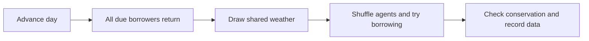

# Model walkthrough

## The rules

There are a fixed number of people and umbrellas. A person may hold at most one umbrella. Each day, overdue trips return their umbrellas first. Shared weather is then drawn. On a rainy day, people without umbrellas try to borrow in shuffled order. A successful borrower keeps an umbrella for `trip_days`; an unsuccessful borrower records a missed request. People already travelling do not request a second umbrella. Dry days create no new requests, but due returns still happen.

People interact indirectly through the station's finite stock. There is no spatial grid, pairwise conversation, queue persistence or real-world dataset. Follow one borrower and one umbrella to trace the rules.

## Agents, model and scheduling

`Borrower` is a Mesa `Agent`. Calling `super().__init__(model)` registers it; code must not manually add it to `model.agents`. Its memory is a return day, successful-loan count, return count and missed-request count. The boolean `has_umbrella` is derived from the return day.

`UmbrellaLibrary` is a Mesa `Model`. It owns the shared stock, day, weather and daily statistics. Its `step()` defines two activation phases:



`agents.do("return_if_due")` finishes every return before any new loan. `agents.shuffle_do("try_borrow")` then randomizes access to scarce umbrellas. Sequential borrowing immediately updates the stock, so two people cannot receive the same umbrella. Changing the phase order would change when returned umbrellas become available.

The pinned Mesa development version schedules the user's step method at unit intervals. `model.step()` advances one unit; `model.run_for(4)` processes four such ticks. A separate `day` field labels this model's observations. Do not recursively call `self.step()` inside the step implementation.

## Follow the four-day reference run

```console
uv run umbrella-demo --agents 3 --umbrellas 1 --trip-days 2 --days 4 --rain 1 --seed 7
```

| Day | Available | Held | Requests | Served | Missed |
|---|---:|---:|---:|---:|---:|
| 0 | 1 | 0 | 0 | 0 | 0 |
| 1 | 0 | 1 | 3 | 1 | 2 |
| 2 | 0 | 1 | 2 | 0 | 2 |
| 3 | 0 | 1 | 3 | 1 | 2 |
| 4 | 0 | 1 | 2 | 0 | 2 |

The first loan starts on day 1 and is due on day 3. On day 2 that borrower is still travelling, so only the other two request umbrellas. At the start of day 3 the umbrella returns and can be borrowed again immediately. By the end of day 4 there have been two loans and one return; one umbrella remains on a trip.

## Conservation and data collection

`available + held == total_umbrellas`, and available stock cannot be negative. Also, each agent's `loans - returns` must be 1 if holding an umbrella and 0 otherwise. Every daily request is either served or missed. These checks expose missing/duplicated umbrellas, double returns and inconsistent counters rather than merely checking that code runs.

`DataCollector` stores a day-zero snapshot and one observation after each step, plus agent histories. Get model results with `model.datacollector.get_model_vars_dataframe()`. The tests check the observations and individual state, including empty stock, no rain, timing and seeded repetition.

## Randomness

Weather uses Mesa's NumPy `rng`. Shuffled activation uses its separate standard-library `random` stream. Both are initialized from the seed. Repeating the same parameters and seed reproduces weather and individual histories. Changing population size does not change the seeded weather sequence in this model; a test verifies that control.

Shuffling changes who gets served. It does not guarantee fairness to every person in a short run. With identical trip durations and fixed weather, aggregate daily service may stay the same even when the identities differ. Inspect individual histories before making claims about fairness.

## Experiments

1. Predict the reference table, then run it. Explain day 2 without looking at the code.
2. Change only `--umbrellas 3`. Predict missed requests and check the result.
3. Restore one umbrella and change only `--trip-days 1`. Explain which quantities change; more loans need not imply fewer missed attempts because people become eligible to request sooner.
4. Try `--rain 0` and `--rain 0.5`. Keep a seed fixed before comparing scenarios.
5. Run the same seed twice, then another seed. Compare individual histories as well as the totals.

An optional CSV export writes a new file and refuses to overwrite one:

```console
uv run umbrella-demo --days 10 --seed 7 --csv run-7.csv
```

The output directory must already exist. This model has no calibrated behaviour, lost umbrellas, unequal trip lengths, spatial travel or persistent waiting queue. These are possible extensions once the basic model is understood.

## Inspect individual histories

After `uv sync --locked`, start `uv run python` and enter:

```python
from models.umbrella_library import UmbrellaLibrary

model = UmbrellaLibrary(n_agents=3, umbrellas=1, rain_probability=1, seed=7)
model.run_for(4)
print(model.datacollector.get_agent_vars_dataframe().to_string())
```

Rows are indexed by time and agent ID. Follow one agent's `has_umbrella`, `loans` and `returns` columns. Repeat with `seed=8` before discussing who was served. Exit Python with `exit()`.
